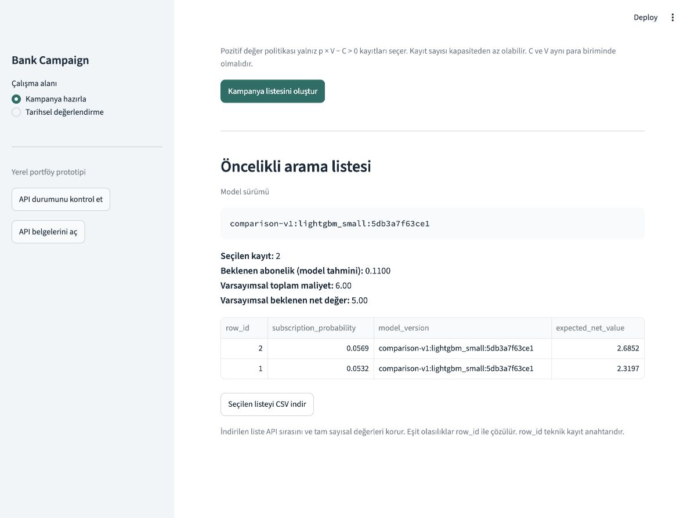

# Bank Campaign Decision Engine

An end-to-end decision-system portfolio project: validate bank marketing data,
freeze an auditable experiment, rank candidates under campaign constraints, and
serve the result through PostgreSQL, FastAPI, and Streamlit.



## What it demonstrates

- Leakage-aware feature design using nine fields assumed available before contact.
- Immutable source-order splits, duplicate controls, and a one-time holdout release.
- Validation-based model selection with artifact and environment provenance.
- A capacity and expected-value policy with deterministic tie-breaking.
- SQL/Python feature parity across all 41,188 source rows.
- Strict FastAPI contracts, a decision workspace, and Docker.
- Honest reporting when a simple business rule beats the selected ML model.

## Measured result

The frozen `lightgbm_small` candidate was selected by validation Average
Precision and evaluated once on 8,236 held-out rows.

| Held-out measure | Result |
|---|---:|
| ROC-AUC | 0.525047 |
| Average Precision | 0.341664 |
| Brier score | 0.278537 |
| Historical subscriptions in top 500 | 231 |
| Random-selection mean at 500 | 154.065 |
| Fixed prior-history rule at 500 | 372 |

The model beat random ranking but did **not** beat the declared history rule.
Its selected top 500 contained 231 historical subscriptions while its
uncalibrated probabilities expected only 39.67. This is evidence of weak
discrimination and material underprediction, not a production success claim.

## System shape

```text
UCI data -> validation/audit -> frozen train/validation/test assignments
                                  |
                                  +-> train-only pipelines -> validation selection
                                  |                            -> frozen holdout report
                                  |
                                  +-> PostgreSQL raw/features -> full parity checks

trusted model release -> SHA-256 verification -> FastAPI -> Streamlit/CSV export
```

Training and evaluation are offline. Online scoring does not require PostgreSQL
or the raw UCI file. The UI calls the API; it does not contain a second scoring
implementation.

## Run the portfolio demo

Prerequisites: Python 3.12, [uv](https://docs.astral.sh/uv/), Docker, and Make.
Local ML tests also need the OpenMP runtime: `brew install libomp` on macOS,
or the distribution's `libgomp1` package on Linux. Docker installs its own runtime.

```bash
git clone https://github.com/yasergirit/bank-campaign-decision-engine.git
cd bank-campaign-decision-engine
make install
make model
make serve
make serving-verify
```

Open the decision workspace at <http://127.0.0.1:18502> and Swagger at
<http://127.0.0.1:18000/docs>. `make model` downloads the project's own
`model-v1` release asset and verifies SHA-256 before writing it. The model stays
outside Git and Docker image layers. The synthetic demo does not need raw data.

Stop only the presentation services with:

```bash
make serving-down
```

## API

| Route | Purpose |
|---|---|
| `GET /health` | Model readiness |
| `GET /model-info` | Version, artifact hash, features, and limitations |
| `POST /score` | Ordered subscription probabilities |
| `POST /campaign/select` | Capacity/value policy and export-ready selection |

Requests reject missing, extra, invalid, or post-contact fields. Example payloads
are in [`examples/`](examples/); the contract is documented in
[`docs/api.md`](docs/api.md).

## Verification

```bash
make check
make test
cp -n .env.example .env
docker compose up -d --wait db
make db-test
docker compose down
```

These commands run static checks, artifact-free tests, an image build, and
isolated PostgreSQL integration tests. The trained model and raw dataset stay
outside the repository. Exact serving is verified separately against the
hash-pinned release artifact.

## Reproduce or inspect

- [`docs/reproduction.md`](docs/reproduction.md) — clean-clone checks, trusted
  model retrieval, and the guarded offline restoration path.
- [`docs/model_card.md`](docs/model_card.md) — intended use and model limits.
- [`reports/test_report.md`](reports/test_report.md) — frozen held-out evidence.
- [`reports/business_case.md`](reports/business_case.md) — decision interpretation.
- [`reports/proje_raporu.md`](reports/proje_raporu.md) / [PDF](reports/proje_raporu.pdf)
  — comprehensive Turkish project report explaining every stage and why it exists.

## Interpretation boundary

This is an offline educational prototype built from historical Portuguese bank
marketing records. A predicted subscription probability is not the causal effect
of making contact. Expected-value outputs use user-supplied cost/value assumptions;
they are not observed profit, incremental revenue, or current-bank performance.
The holdout is already exposed, so future model development requires a new
evaluation design rather than further tuning against these results.

Data source: [UCI Bank Marketing](https://archive.ics.uci.edu/dataset/222/bank+marketing).
